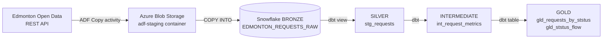

# Edmonton 311 Requests: Azure Data Factory → Snowflake → dbt

A dbt and Snowflake project that transforms Edmonton open-data service-request records from a **Bronze** ingestion layer through **Silver** staging and **Intermediate** metrics into **Gold** reporting tables. Data is ingested by **Azure Data Factory (ADF)** from the City of Edmonton's public REST API and staged through Azure Blob Storage into Snowflake.

> Built as a hands-on data engineering portfolio project (medallion architecture, ELT with dbt).

---

## Table of Contents

- [Architecture](#architecture)
- [Tech Stack](#tech-stack)
- [Data Source](#data-source)
- [Repository Structure](#repository-structure)
- [Setup Guide](#setup-guide)
  - [1. Snowflake](#1-snowflake)
  - [2. Azure Data Factory ingestion](#2-azure-data-factory-ingestion)
  - [3. dbt project](#3-dbt-project)
- [Data Layers & Models](#data-layers--models)
- [Running the Project](#running-the-project)
- [Troubleshooting Notes](#troubleshooting-notes)
- [Security Notes](#security-notes)
- [Screenshots](#screenshots)
- [Roadmap](#roadmap)

---

## Architecture



| Layer | Purpose | Built by |
|---|---|---|
| **Bronze** | Raw, as-ingested API records plus an `INGESTED_AT` audit timestamp | Azure Data Factory |
| **Silver** | Cleaned and typed staging model (`stg_requests`) | dbt |
| **Intermediate** | Derived business fields (resolution time, status category, etc.) | dbt |
| **Gold** | Reporting-ready aggregate tables | dbt |

---

## Tech Stack

- **Snowflake** (free trial account): warehouse, database, schemas, roles
- **Azure Data Factory V2**: REST → Snowflake ingestion pipeline
- **Azure Blob Storage**: staging area used by the ADF Copy activity (SAS authentication)
- **dbt Core** with the `dbt-snowflake` adapter
- **Python 3.11** (conda environment `edmonton-dbt`)
- **Git / GitHub**, VS Code

---

## Data Source

City of Edmonton Open Data portal: service/data request records.

- Base URL: `https://data.edmonton.ca/`
- Dataset ID: `a9w6-s3na`
- Endpoint: `https://data.edmonton.ca/api/v3/views/a9w6-s3na/query.json`
- ADF relative URL used for the copy: `resource/a9w6-s3na.json?$limit=5`
- Authentication: anonymous (public API)

Fields ingested: `request_number`, `request_description`, `request_details`, `request_creation_date`, `status`, `status_date`, plus `ingested_at` added at load time.

---

## Repository Structure

```
Edmonton-adf-snowflake-dbt/
├── analyses/
├── macros/
│   ├── generate_schema_name.sql      # custom schema naming (exact schema names)
│   └── status_categorization.sql     # status bucketing macro
├── models/
│   ├── staging/
│   │   ├── sources.yml
│   │   ├── schema.yml
│   │   └── stg_requests.sql
│   ├── intermediate/
│   │   ├── schema.yml
│   │   └── int_request_metrics.sql
│   └── marts/
│       ├── gld_requests_by_ststus.sql
│       └── gld_ststus_flow.sql
├── seeds/
├── snapshots/
├── tests/
├── 01_setup_snowflake.sql            # warehouse, DB, schemas, ADF role/user, grants, validation queries
├── dbt_project.yml
├── requirements.txt
└── README.md
```

---

## Setup Guide

### 1. Snowflake

All DDL lives in [`01_setup_snowflake.sql`](01_setup_snowflake.sql).

**Warehouse, database and schemas**

```sql
CREATE WAREHOUSE IF NOT EXISTS AZUREDF_DBT_WH
  WAREHOUSE_SIZE = 'XSMALL'
  AUTO_SUSPEND = 60
  AUTO_RESUME = TRUE
  INITIALLY_SUSPENDED = TRUE;

CREATE DATABASE IF NOT EXISTS AZUREDF_DBT_DB;
CREATE SCHEMA IF NOT EXISTS AZUREDF_DBT_DB.BRONZE;
CREATE SCHEMA IF NOT EXISTS AZUREDF_DBT_DB.SILVER;
CREATE SCHEMA IF NOT EXISTS AZUREDF_DBT_DB.INTERMEDIATE;
CREATE SCHEMA IF NOT EXISTS AZUREDF_DBT_DB.GOLD;
```

Verify:

```sql
SHOW WAREHOUSES LIKE 'AZUREDF_DBT_WH';
SHOW SCHEMAS IN DATABASE AZUREDF_DBT_DB;
```

**Role and user for Data Factory** (least-privilege ingestion role)

```sql
CREATE ROLE IF NOT EXISTS ADF_INGEST_ROLE;

CREATE USER IF NOT EXISTS azure_adfuser
  PASSWORD = '<choose-a-strong-password>'
  DEFAULT_ROLE = ADF_INGEST_ROLE
  DEFAULT_WAREHOUSE = AZUREDF_DBT_WH;

GRANT ROLE ADF_INGEST_ROLE TO USER azure_adfuser;
GRANT USAGE ON WAREHOUSE AZUREDF_DBT_WH TO ROLE ADF_INGEST_ROLE;
GRANT USAGE ON DATABASE AZUREDF_DBT_DB TO ROLE ADF_INGEST_ROLE;
GRANT USAGE, CREATE TABLE ON SCHEMA AZUREDF_DBT_DB.BRONZE TO ROLE ADF_INGEST_ROLE;
GRANT SELECT, INSERT, UPDATE, DELETE ON FUTURE TABLES IN SCHEMA AZUREDF_DBT_DB.BRONZE TO ROLE ADF_INGEST_ROLE;
```

**Additional grants required for ADF staging** (run as `ACCOUNTADMIN`)

```sql
USE ROLE ACCOUNTADMIN;

GRANT CREATE STAGE ON SCHEMA AZUREDF_DBT_DB.BRONZE TO ROLE ADF_INGEST_ROLE;
GRANT CREATE FILE FORMAT ON SCHEMA AZUREDF_DBT_DB.BRONZE TO ROLE ADF_INGEST_ROLE;
GRANT USAGE ON DATABASE AZUREDF_DBT_DB TO ROLE ADF_INGEST_ROLE;
GRANT USAGE ON SCHEMA AZUREDF_DBT_DB.BRONZE TO ROLE ADF_INGEST_ROLE;
GRANT INSERT, SELECT ON ALL TABLES IN SCHEMA AZUREDF_DBT_DB.BRONZE TO ROLE ADF_INGEST_ROLE;
```

### 2. Azure Data Factory ingestion

**Azure resources**

| Resource | Name | Notes |
|---|---|---|
| Resource group | `rg-azuredf-dbt-dev` | Region only holds metadata |
| Data Factory (V2) | `adf-azuredf-dbt-dev` | Central India (closest to the Snowflake account) |
| Storage account / container | `dflake` / `adf-staging` | Blob staging for the Copy activity |

**Linked services** (ADF Studio → Manage → Linked services)

| Name | Type | Key settings |
|---|---|---|
| `ls_snowflake_azuredf` | Snowflake V2 | DB `AZUREDF_DBT_DB`, warehouse `AZUREDF_DBT_WH`, basic auth as `azure_adfuser`, role `ADF_INGEST_ROLE` |
| `ls_edmonton_open_data_api` | REST | Base URL `https://data.edmonton.ca/`, anonymous auth |
| `ls_adf_staging_blob` | Azure Blob Storage | SAS authentication, container `adf-staging` |

**Pipeline** (`test_url_pipeline`)

1. **`Web1`** (Web activity): `GET` on `https://data.edmonton.ca/api/v3/views/a9w6-s3na/query.json?$query=SELECT * LIMIT 5` to confirm the API responds.
2. **`Copy_Edmonton_To_Snowflake`** (Copy data activity), connected from `Web1` on success.
   - **Source:** REST dataset (`Rest_datasetResource1`), relative URL `resource/a9w6-s3na.json?$limit=5`.
   - **Sink:** Snowflake dataset (`SnowflakeTable1`) → `AZUREDF_DBT_DB.BRONZE.EDMONTON_REQUESTS_RAW`.
   - **Mapping:** imported schema mapped to the six source fields.
   - **Staging:** enabled, using `ls_adf_staging_blob` and the `adf-staging` container.

> **Why staging?** ADF reported that direct REST-to-Snowflake copy isn't supported for this setup. With staging, ADF writes the data to Blob storage as files, then Snowflake loads them with `COPY INTO`, which is also faster than row-by-row inserts.

Validate → Debug → confirm both activities succeed → **Publish all**.

Check the loaded data:

```sql
SELECT * FROM AZUREDF_DBT_DB.BRONZE.EDMONTON_REQUESTS_RAW LIMIT 20;
SELECT COUNT(*) AS cnt FROM AZUREDF_DBT_DB.BRONZE.EDMONTON_REQUESTS_RAW;
```


### 3. dbt project

Create the environment and install dbt:

```bash
conda create -n edmonton-dbt python=3.11 pip -y
conda activate edmonton-dbt
python -m pip install dbt-snowflake      # or: pip install -r requirements.txt
dbt --version
```

Initialise the project (choose **Snowflake** as the adapter):

```bash
dbt init edmonton_pipeline
```

Configure your connection in `profiles.yml` (see [Security Notes](#security-notes); use environment variables rather than hard-coded credentials):

```yaml
edmonton_pipeline:
  target: dev
  outputs:
    dev:
      type: snowflake
      account: "{{ env_var('SNOWFLAKE_ACCOUNT') }}"
      user: "{{ env_var('SNOWFLAKE_USER') }}"
      password: "{{ env_var('SNOWFLAKE_PASSWORD') }}"
      role: "{{ env_var('SNOWFLAKE_ROLE') }}"
      database: AZUREDF_DBT_DB
      warehouse: AZUREDF_DBT_WH
      schema: DBT_DEV
      threads: 4
```

Check the connection:

```bash
dbt debug
```

---

## Data Layers & Models

### Silver: `models/staging/`

**`stg_requests`**: reads from the Bronze source (`EDMONTON_REQUESTS_RAW`, declared in `sources.yml`) and outputs typed, cleaned columns:

| Column | Type |
|---|---|
| `REQUEST_NUMBER` | VARCHAR |
| `REQUEST_DESCRIPTION` | VARCHAR |
| `REQUEST_DETAILS` | VARCHAR |
| `REQUEST_CREATION_DATE` | DATE |
| `STATUS` | VARCHAR |
| `STATUS_DATE` | DATE |
| `INGESTED_AT` | TIMESTAMP_NTZ |

Silver-layer work covers renaming to clean business names, type conversion, date parsing, null handling and filtering bad records.

### Intermediate: `models/intermediate/`

**`int_request_metrics`**: derived fields per request:

- `days_to_resolution`
- `status_category` (buckets such as *Resolved*, *Closed – Not Resolved*, *Open*, *Unknown*, via the `status_categorization` macro)
- `request_complexity`
- `completeness_score`

### Gold: `models/marts/` (materialised as Snowflake tables)

| Model | Description |
|---|---|
| `gld_requests_by_ststus` | Request counts and resolution metrics by status category and status, for status-based reporting |
| `gld_ststus_flow` | Per status: total requests, requests with a status date, and the earliest and latest status dates |

> The `ststus` spelling is the actual model/table name in this repo (`GLD_REQUESTS_BY_STSTUS`, `GLD_STSTUS_FLOW`). Rename both together with any downstream references if you correct it.

### Macros

- **`generate_schema_name.sql`**: overrides dbt's default schema naming so models land in the exact `INTERMEDIATE` and `GOLD` schemas instead of being prefixed with `DBT_DEV_`.
- **`status_categorization.sql`**: reusable logic that groups raw statuses into categories.

---

## Running the Project

```bash
conda activate edmonton-dbt
dbt debug          # verify connection
dbt run            # build all models
dbt test           # run schema tests (defined in schema.yml files)
dbt build          # run + test in DAG order
```

Verify in Snowflake:

```sql
SELECT * FROM AZUREDF_DBT_DB.DBT_DEV_SILVER.STG_REQUESTS LIMIT 20;
SELECT * FROM AZUREDF_DBT_DB.DBT_DEV_INTERMEDIATE.INT_REQUEST_METRICS LIMIT 20;
SELECT * FROM AZUREDF_DBT_DB.GOLD.GLD_REQUESTS_BY_STSTUS LIMIT 20;
SELECT * FROM AZUREDF_DBT_DB.GOLD.GLD_STSTUS_FLOW LIMIT 20;
```

Inspect the Silver column types:

```sql
SELECT column_name, data_type
FROM AZUREDF_DBT_DB.information_schema.columns
WHERE table_schema = 'DBT_DEV_SILVER' AND table_name = 'STG_REQUESTS'
ORDER BY ordinal_position;
```

---

## Troubleshooting Notes

Issues hit while building the ingestion pipeline and how they were fixed:

| Problem | Fix |
|---|---|
| `UserErrorInvalidSasUri`: SAS URI must be `<storageUri>?<sasToken>` | Put the storage endpoint in the **SAS URL** box and the token in the separate **SAS token** box |
| Staging authentication validation error | Switched the Blob linked service from account key to **SAS authentication** |
| SAS too narrow | Generated an **account-level SAS** (Blob; Service + Container + Object) over HTTPS with an expiry covering the test |
| Copy failed on the Snowflake side | `GRANT CREATE STAGE ON SCHEMA AZUREDF_DBT_DB.BRONZE TO ROLE ADF_INGEST_ROLE;` (plus `CREATE FILE FORMAT`) |
| Direct REST → Snowflake copy not supported | Enabled **staging** via Blob storage |

---

## Security Notes

- **Never commit credentials.** Keep Snowflake passwords, the Azure SAS token and account keys out of the repo. Use environment variables (`.env`, git-ignored) and reference them in `profiles.yml` with `env_var()`.
- Rotate any password or SAS token that has ever been committed or pasted into shared documents. Use a strong password for `azure_adfuser`, not the placeholder.
- Use short-lived, minimally scoped SAS tokens.
- Keep `target/`, `logs/`, `dbt_packages/`, `.env` and `.DS_Store` in `.gitignore`.

---

## Screenshots

**Snowflake layers (Bronze, Intermediate, Gold)**


**Project structure**


---

## Roadmap

- [ ] Increase the ADF extract from the `$limit=5` test to the full dataset, with pagination
- [ ] Add a scheduled/tumbling-window ADF trigger for incremental loads
- [ ] Add dbt tests (`unique`, `not_null`, `accepted_values`) and model documentation (`dbt docs generate`)
- [ ] Add a `dim_departments` model and a `fct_requests_by_status` fact model
- [ ] Connect a BI-ready mart to a dashboard tool
- [ ] Add CI (GitHub Actions) to run `dbt build` on pull requests

---

## Author

**Tanish Waghule**: [GitHub @TANISH255](https://github.com/TANISH255)
